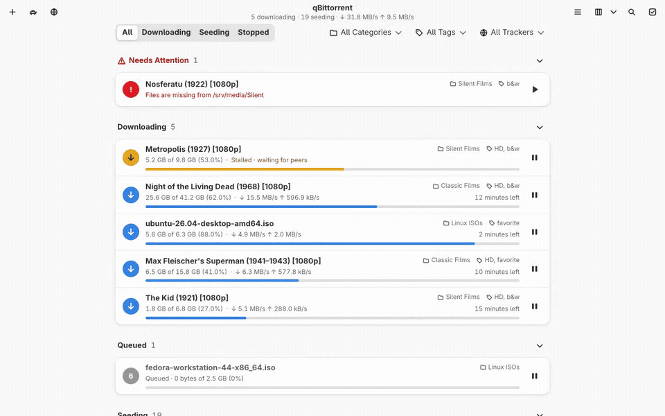
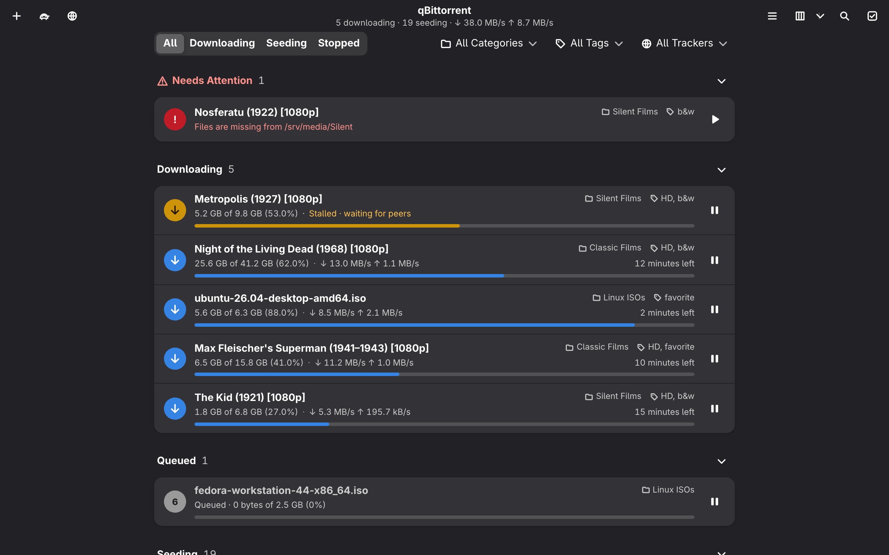
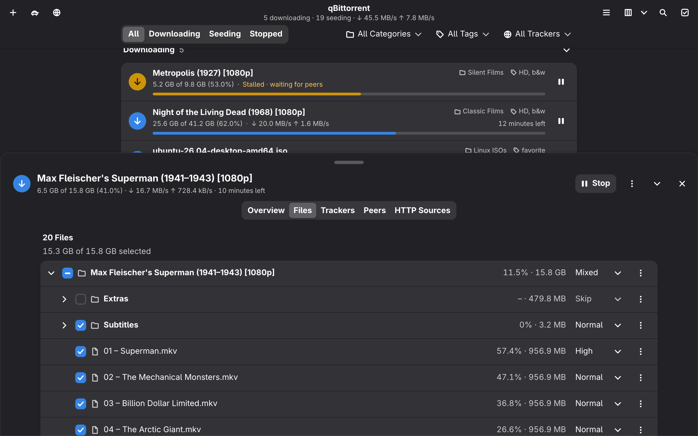
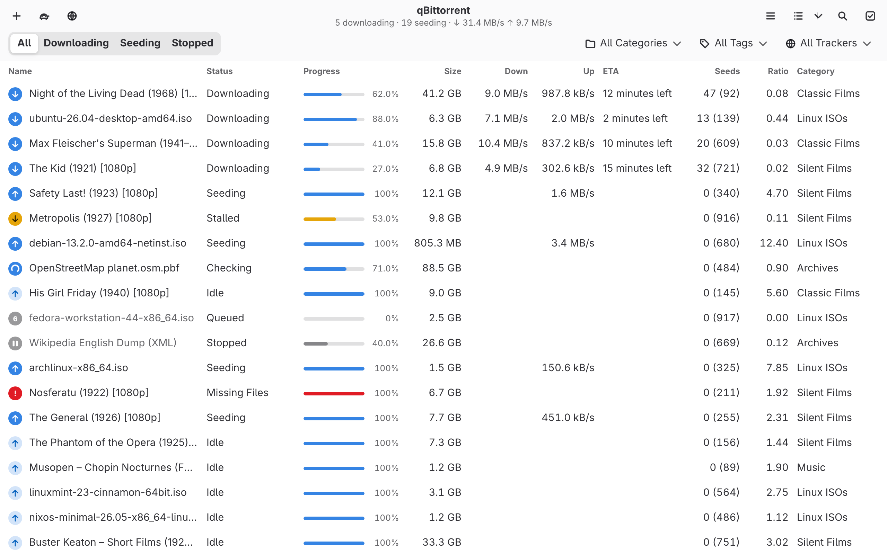
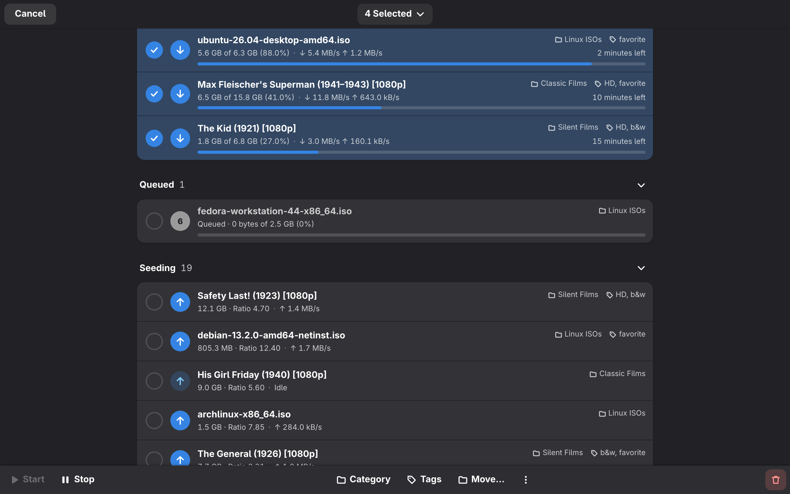
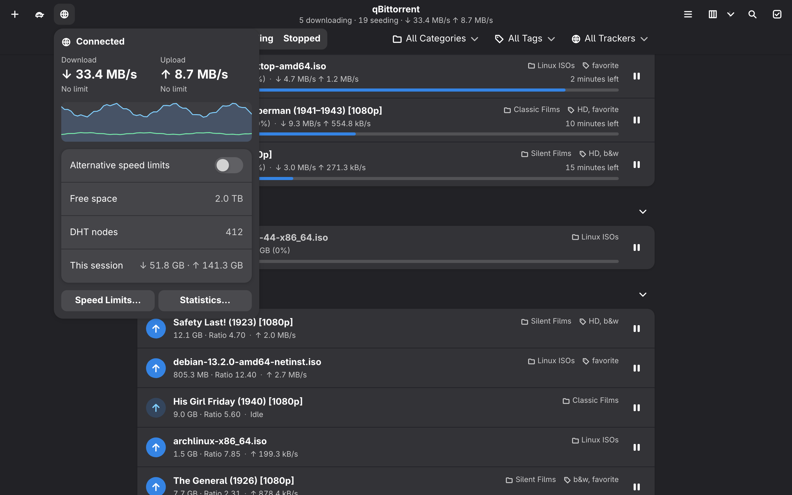
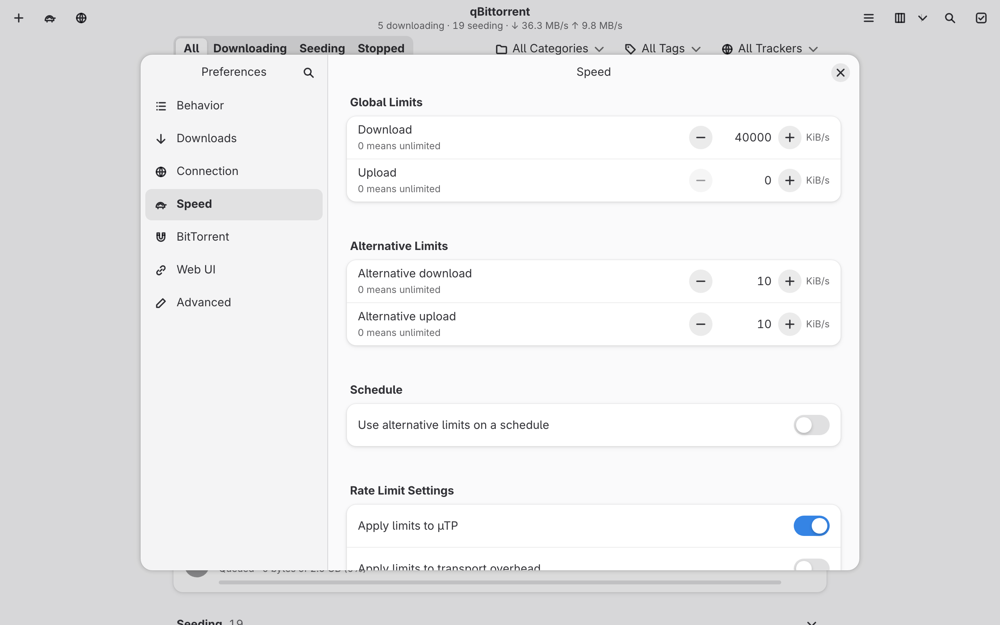
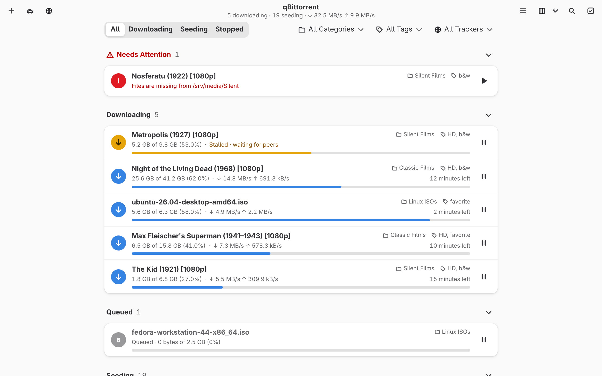
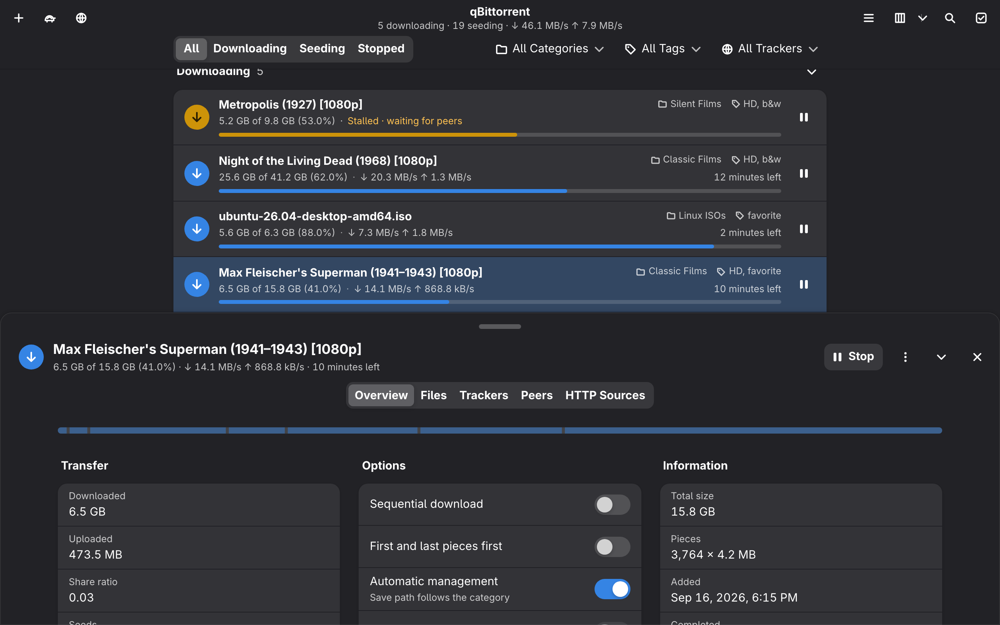

# qBittorrent Adwaita

**qBittorrent's Web UI, redesigned as a GNOME app.**

**[Download](https://github.com/jatinrai2911/qbittorrent-adwaita/releases/latest)** · [Install in 3 steps](#install) · [User guide](docs/guide.md) · [Changelog](CHANGELOG.md)

 

## Your library, at a glance

Grouped by what needs you: problems first, then downloading, seeding, queued and stopped.

## Every detail, one click away

A resizable sheet with the piece map, files and priorities, trackers, peers and web seeds.

## Built for big libraries

<table>
<tr>
<td width="50%"> <b>A dense, sortable table</b>, virtualized for thousands of torrents.</td>
<td width="50%"> <b>Selection mode</b> acts on many at once, with Undo.</td>
</tr>
<tr>
<td width="50%"> <b>Live status</b>: speeds, limits, disk space, connection health.</td>
<td width="50%"> <b>Every setting</b>, searchable, applied as you change it.</td>
</tr>
<tr>
<td width="50%"> <b>Light and dark</b>, following your system.</td>
<td width="50%"> <b>Overview</b> with the piece map, transfer and options.</td>
</tr>
</table>

## And everything else

**Keyboard-first:** arrows, Space, Delete, F2, Enter, type-to-search ·
**Accessible:** WCAG AA in both themes, screen readers, high contrast, reduced motion ·
**Private:** passkeys masked, no third-party requests ·
**Add anything:** paste a magnet anywhere or drop `.torrent` files, with a file preview ·
**Complete:** filters, categories, tags, trackers, speed limits and scheduler, statistics, execution log,
torrent creator, cookies

## Install

1. **Download** the [latest release](https://github.com/jatinrai2911/qbittorrent-adwaita/releases/latest) zip and unzip it.
2. **In qBittorrent**, open *Tools → Options → Web UI*, tick **Use alternative WebUI**, and set
   **Files location** to the unzipped `qbittorrent-adwaita` folder.
3. **Open your Web UI** and log in.

The [user guide](docs/guide.md) covers headless and Docker setups, switching back, shortcuts and the
FAQ.

 

Free software under the <a href="LICENSE">GPL-3.0-or-later</a> · <a href="CONTRIBUTING.md">Contributing</a> · <a href="SECURITY.md">Security</a> 
An independent project, not affiliated with qBittorrent or GNOME. The screenshots show a made-up
library of public-domain films, Linux ISOs and open archives.

